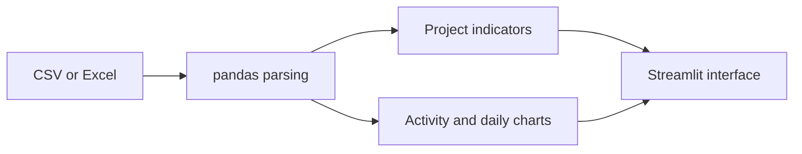

# Project Performance Dashboard

A Python and Streamlit prototype for reviewing project progress and cost data from CSV or Excel files. It brings earned value indicators, activity comparisons, and cumulative progress curves into one interface.

**Status:** application prototype. Input validation and error handling are still being improved. A hosted demo is not currently linked.

## What it does

- Reads project and daily progress data from CSV/XLSX uploads.
- Displays planned value (PV), earned value (EV), and actual cost (AC).
- Calculates CPI, SPI, schedule variance, and cost variance.
- Compares planned and actual activity progress with Plotly charts.
- Displays a cumulative progress curve from daily data.

The interface is currently in Persian. English descriptions below explain the file format and implementation.

## Run locally

From the repository root, create an isolated Python environment:

```powershell
python -m venv .venv
.\.venv\Scripts\python.exe -m pip install -r requirements.txt
.\.venv\Scripts\python.exe -m streamlit run PM3.py
```

On macOS/Linux, replace `.\.venv\Scripts\python.exe` with `.venv/bin/python`.

These commands point to the actual entry file. Installation and the complete UI flow have not yet been verified in a fresh environment.

For the first trial, upload **both** sample files:

1. Project input: [examples/project_sample.csv](examples/project_sample.csv)
2. Daily input: [examples/daily_progress_sample.csv](examples/daily_progress_sample.csv)

The current project-only upload path has a known error; use both files until that path is fixed. See [ROADMAP.md](ROADMAP.md).

## Input format

Project file:

| Column | Meaning |
| --- | --- |
| `Activity` | Activity name |
| `PV` | Planned value at the reporting date |
| `EV` | Earned value at the reporting date |
| `AC` | Actual cost at the reporting date |
| `Planned %` | Planned progress, on a 0–100 scale |
| `Actual %` | Actual progress, on a 0–100 scale |

Daily file:

| Column | Meaning |
| --- | --- |
| `Date` | Reporting date in `YYYY-MM-DD` format |
| `Activity` | Series/activity label |
| `Planned_EV` | Cumulative planned value |
| `Actual_EV` | Cumulative earned value, not actual cost |

Column names must match exactly. The supplied daily example contains one project-level series with one row per date. Multi-series daily aggregation is not implemented in the current chart.

Use the same currency or budget unit for all monetary values. The example data is entirely synthetic. See [the sample data notes](examples/README.md).

## Sample arithmetic

For the supplied project file:

| Indicator | Expected arithmetic |
| --- | --- |
| Total PV | 100,000 |
| Total EV | 85,000 |
| Total AC | 94,000 |
| SPI = EV / PV | 0.85 |
| CPI = EV / AC | approximately 0.9043 |
| SV = EV − PV | −15,000 |
| CV = EV − AC | −9,000 |

These are checks on the sample inputs, not results from a completed UI test. The prototype currently derives BAC from total PV and labels EV/PV as progress. Those assumptions need to be made explicit before using arbitrary reporting snapshots.

## Implementation



The current implementation lives in [PM3.py](PM3.py). It uses pandas/NumPy for calculations and Plotly for charts.

## Development priorities

The next steps are input validation, the project-only upload fix, explicit budget definitions, and tests for the core calculations. The existing Dockerfile is empty; a working container setup is not currently provided.

See [ROADMAP.md](ROADMAP.md) for concrete completion criteria.

Built by [Roxana Khaleghi](https://github.com/roxanakhaleghi67).
