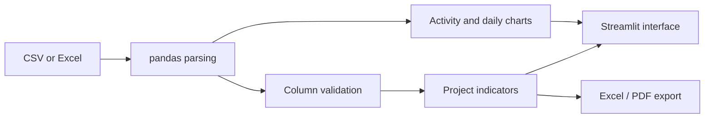

# Project Performance Dashboard

A Python and Streamlit prototype for reviewing project progress and cost data from CSV or Excel
files. It brings earned value indicators, activity comparisons, cumulative progress curves and a
downloadable report into one interface.

**Status:** working prototype. Input validation, the project-only upload path and Excel/PDF export
are implemented. Automated tests and a hosted demo are still missing.

## What it does

- Reads project and daily progress data from CSV/XLSX uploads.
- Validates the required columns and shows a clear message when one is missing.
- Displays planned value (PV), earned value (EV), and actual cost (AC).
- Calculates CPI, SPI, schedule variance, cost variance, EAC, ETC and VAC.
- Compares planned and actual activity progress with Plotly charts.
- Displays a cumulative progress curve from daily data, or a synthetic one from the project file.
- Exports the indicators and the task table as **Excel** and a one-page **PDF**.

The interface is currently in Persian. English descriptions below explain the file format and
implementation.

## Run locally

From the repository root, create an isolated Python environment:

```powershell
python -m venv .venv
.\.venv\Scripts\python.exe -m pip install -r requirements.txt
.\.venv\Scripts\python.exe -m streamlit run PM3.py
```

On macOS/Linux, replace `.\.venv\Scripts\python.exe` with `.venv/bin/python`.

For the first trial, upload **both** sample files:

1. Project input: [examples/project_sample.csv](examples/project_sample.csv)
2. Daily input: [examples/daily_progress_sample.csv](examples/daily_progress_sample.csv)

The project file alone is also enough now: the app shows the indicators and builds a synthetic
S-curve from it.

## Input format

Project file:

| Column | Meaning |
| --- | --- |
| `Activity` | Activity name |
| `PV` | Planned value at the reporting date |
| `EV` | Earned value at the reporting date |
| `AC` | Actual cost at the reporting date |
| `Planned %` | Planned progress, on a 0–100 scale |
| `Actual %` | Actual progress, on a 0–100 scale |

Daily file:

| Column | Meaning |
| --- | --- |
| `Date` | Reporting date in `YYYY-MM-DD` format |
| `Activity` | Series/activity label |
| `Planned_EV` | Cumulative planned value |
| `Actual_EV` | Cumulative earned value, not actual cost |

Column names must match exactly (surrounding spaces are stripped). Use the same currency or budget
unit for all monetary values. The example data is entirely synthetic; see
[the sample data notes](examples/README.md).

## Sample arithmetic

For the supplied project file:

| Indicator | Expected arithmetic |
| --- | --- |
| Total PV | 100,000 |
| Total EV | 85,000 |
| Total AC | 94,000 |
| SPI = EV / PV | 0.85 |
| CPI = EV / AC | approximately 0.9043 |
| SV = EV − PV | −15,000 |
| CV = EV − AC | −9,000 |

These are checks on the sample inputs. The prototype derives BAC from total PV and labels EV/PV as
progress; state those assumptions yourself before using arbitrary reporting snapshots.

## Implementation



The implementation lives in [PM3.py](PM3.py). It uses pandas/NumPy for calculations, Plotly for
charts, openpyxl for the Excel export and reportlab for the PDF.

## Development priorities

Add tests for the core calculations, make the budget assumptions configurable, and publish a hosted
demo. See [ROADMAP.md](ROADMAP.md) for completion criteria.

Built by [Roxana Khaleghi](https://github.com/roxanakhaleghi67).